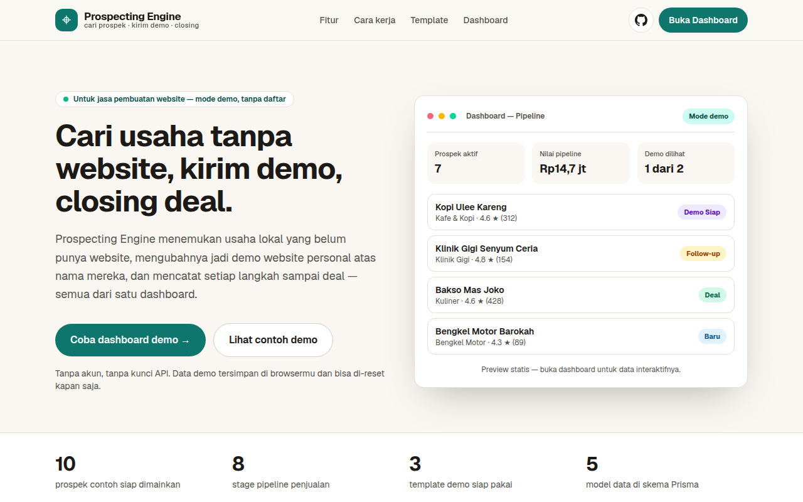
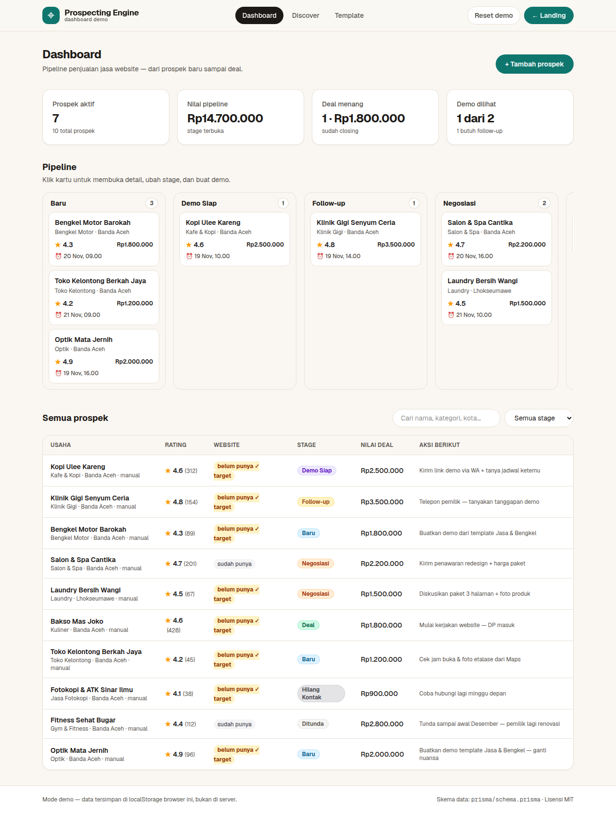
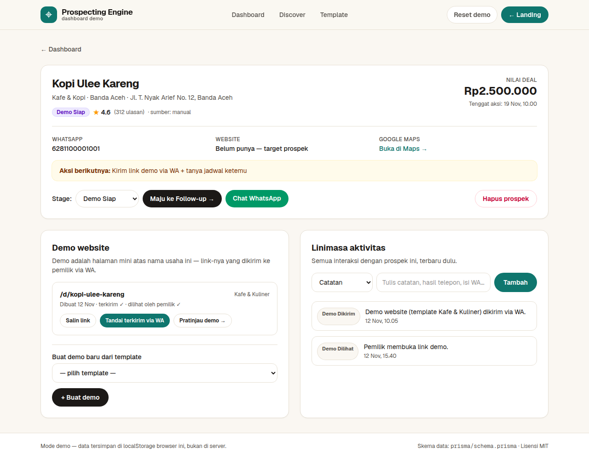
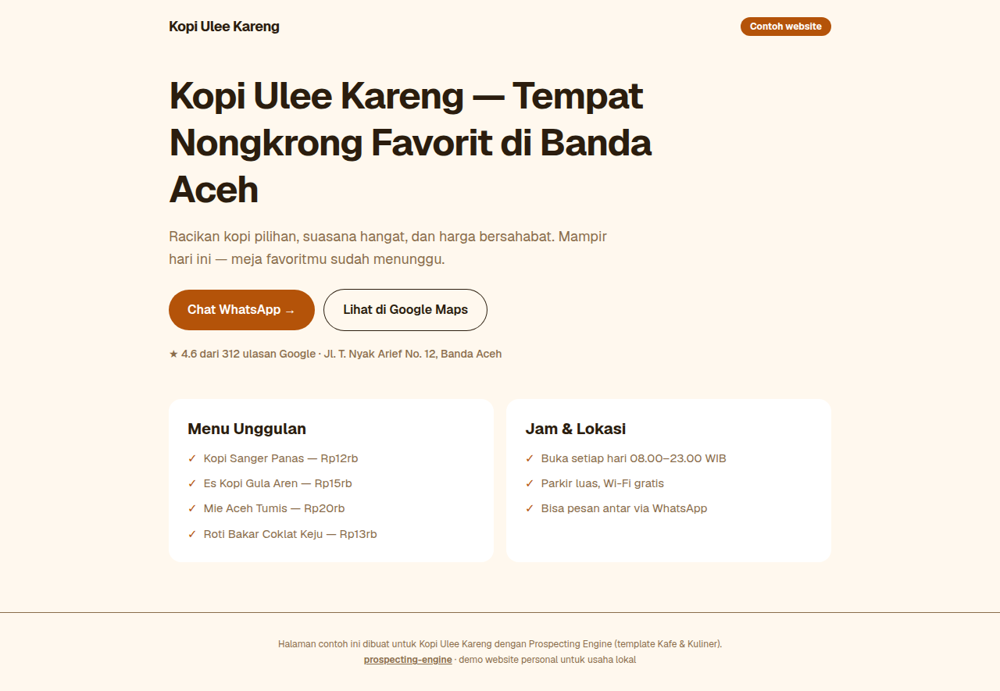

# Prospecting Engine

**Cari usaha tanpa website, kirim demo, closing deal** — mesin prospeksi untuk jasa
pembuatan website: temukan usaha lokal yang belum punya website, kelola pipeline
penjualan, buat demo website personal atas nama mereka, dan pantau siapa yang
membuka demonya.

🌐 **Live:** https://prospecting-engine.pages.dev
📄 **Docs:** [`docs/README.md`](./docs/README.md) · **PRD:** [`PRD.md`](./PRD.md)



## Coba langsung — tanpa daftar

Buka https://prospecting-engine.pages.dev, klik **Coba dashboard demo**, dan
dashboard langsung jalan di browser: pipeline Kanban 8 stage, 10 prospek contoh,
3 template demo, dan 1 Discover job selesai. Tanpa akun, tanpa kunci API.
Data tersimpan di localStorage — refresh halaman dan datamu tetap ada.

📹 **Video demo:** [`docs/demo/demo.mp4`](./docs/demo/demo.mp4) (18 detik)

## Fitur

| Fitur | Status |
|---|---|
| Landing SaaS (navbar + GitHub, hero + preview produk, fitur, cara kerja, footer) | ✅ |
| Dashboard — statistik pipeline, Kanban 8 stage, tabel prospek + cari & filter | ✅ mode demo |
| Tambah/ubah/hapus prospek; pindah stage tercatat otomatis di linimasa | ✅ mode demo |
| Detail prospek — aktivitas (catatan, panggilan, WA), aksi berikut + tenggat | ✅ mode demo |
| Template demo (Kafe & Kuliner, Klinik & Kesehatan, Jasa & Bengkel) | ✅ mode demo |
| Buat demo website personal per prospek — halaman publik `/d/<slug>` | ✅ mode demo |
| Demo dibuka pemilik → tercatat "dilihat" (sinyal follow-up) | ✅ mode demo |
| Discover — cari usaha per kata kunci + kota, import ke pipeline | ✅ mode demo (data contoh) |
| Skema Prisma (Prospect, Activity, Template, Demo, DiscoverJob) | ✅ skema, mode Postgres terdokumentasi |
| Discover via Google Maps Places API + Playwright | 📋 fase 2 — butuh kunci API |

## Screenshot







Screenshot lengkap: [`docs/screenshots/`](./docs/screenshots/) — hero, full
landing, dashboard, detail, Discover, template, demo, mobile, dan hasil
play-test tambah prospek.

## Tech stack

- **Frontend:** Next.js 16.4.6 (App Router, static export) + React 19 +
  Tailwind CSS v4
- **Data (mode demo):** localStorage + seed — lihat
  [`src/lib/store.tsx`](./src/lib/store.tsx) dan
  [`src/lib/seed.ts`](./src/lib/seed.ts)
- **Data (mode server):** Prisma 7 + PostgreSQL — lihat
  [`prisma/schema.prisma`](./prisma/schema.prisma) dan
  [`docs/SCHEMA.md`](./docs/SCHEMA.md)
- **Testing:** Playwright e2e (8 tes) + tes unit Pages Worker (node --test)
- **Deploy:** Cloudflare Pages (static export + `_worker.js`) — lihat
  [`docs/DEPLOYMENT.md`](./docs/DEPLOYMENT.md)

## Menjalankan

```bash
npm install
npm run dev      # http://localhost:3000

npm run build    # static export ke out/ (+ copy worker/_worker.js)
npm run serve    # sajikan out/ di http://127.0.0.1:8336
npm test         # tes unit Pages Worker
npm run test:e2e # Playwright (butuh build + serve jalan)
npm run lint && npm run typecheck
```

Mode demo tidak butuh environment variable apa pun. Untuk mode Postgres,
salin `.env.example` ke `.env` dan isi `DATABASE_URL`, lalu
`npx prisma migrate dev` — lihat [`docs/SCHEMA.md`](./docs/SCHEMA.md).

## Struktur proyek

```
src/
  app/
    page.tsx                 # landing SaaS
    app/                     # dashboard: page, discover, template
    app/prospek/[id]/        # detail prospek
    d/[slug]/                # halaman demo publik per prospek
  components/                # ui.tsx (badge, kartu, dsb.)
  lib/
    types.ts                 # tipe cerminan schema.prisma
    seed.ts                  # data contoh mode demo
    store.tsx                # store localStorage + aksi bisnis
prisma/
  schema.prisma              # model Prospect/Activity/Template/Demo/DiscoverJob
worker/
  _worker.js                 # Pages Worker: /api/status + shell fallback
  _worker.test.mjs           # tes unit worker
e2e/                         # Playwright: landing, dashboard, discover
scripts/
  advisory-sweep.py          # sweep OSV (produksi, high/critical)
  serve.mjs                  # server statis ala Pages + shell fallback
  shots.mjs                  # screenshot README/video
docs/
  PRD.MD SDD.MD ARCHITECTURE.md SCHEMA.md DESIGN.MD SECURITY.md
  DEPLOYMENT.md DEMO.md ROADMAP.md DIAGRAMS.html
  screenshots/ demo/
```

## Keamanan

Tidak ada secret yang ter-commit. Satu-satunya yang mirip kredensial di
riwayat adalah URL Postgres dev lokal di `prisma.config.ts` — sudah
dipindah ke `DATABASE_URL` (lihat [`docs/SECURITY.md`](./docs/SECURITY.md)).
Discover mode demo memakai data contoh berlabel, bukan data Maps asli.

## Lisensi

MIT — lihat [LICENSE](./LICENSE).

---
_Dikembangkan oleh **dezzorigin** (Nabil Aulia Dika)._
